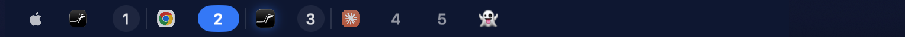

# Lefty

A quiet bar with pill-shaped workspaces, a blue accent and a slow glow.

## Previews

The optional left-side setup described below, with a matched cover and the native palette. The default is a full-width bar.



## What it changes

A 40 pt full-width bar on neutral greys that follows the system's light and dark appearance. Workspaces are numbered circles, and the focused one becomes a filled blue pill; the accent is otherwise kept for primary controls. Popouts have rounded panels and groups. A shader draws a slow glow and a few sparks along the bottom edge, below the text.

## Controls and commands

Widgets keep their usual controls. Adjust Glow under **Settings > Styles & Widgets > Bar**: intensity, motion speed, spark size and glow height. Set intensity to 0 for a plain bar, motion speed to 0 for a still one, or spark size to 0 for the glow alone.

To keep the native macOS menu bar items on the right, turn **Full Width** off. Then either use the notch mode **Fill Left of Notch** with **Solid Black Background** and the Lefty Dark palette, or give the workspaces widget an opaque cover in `shell.toml`, so the app menus do not show through a transparent bar:

```toml
[profiles.lefty]
leading = ["workspaces"]
center = []
trailing = []

[profiles.lefty.workspaceBar]
fullWidth = false
notchMode = "off"
height = 32
transparentBackground = true
solidBlackBackground = false
xOffset = -529                 # (coverWidth + 8) / 2 - half the display's width
yOffset = 1                    # menu bar height minus the bar's height

[profiles.lefty.widgets.workspaces]
indicator = "numbers"
cover = "#0C1733"              # a #RRGGBB colour close to your wallpaper's top edge
coverWidth = 662               # wide enough for app menus, clear of icons left of the notch
```

These values are for a 1728 pt wide display. The cover is one fixed colour and width, so it suits a still wallpaper and one display. It adds Apple and app menu buttons. The glow is not drawn in either setup. Menu bar icons that macOS moves to the left of the notch stay usable when the cover ends before them, which Fill Left of Notch does not allow.

## Credits and licences

Style code is GPL-2.0-only, as declared in [style.toml](style.toml). The look module follows the structure of OmniWM's Sakura style, (C) 2026 OmniNull, GPL-2.0-only. No fonts or images are bundled; text uses the system font.
